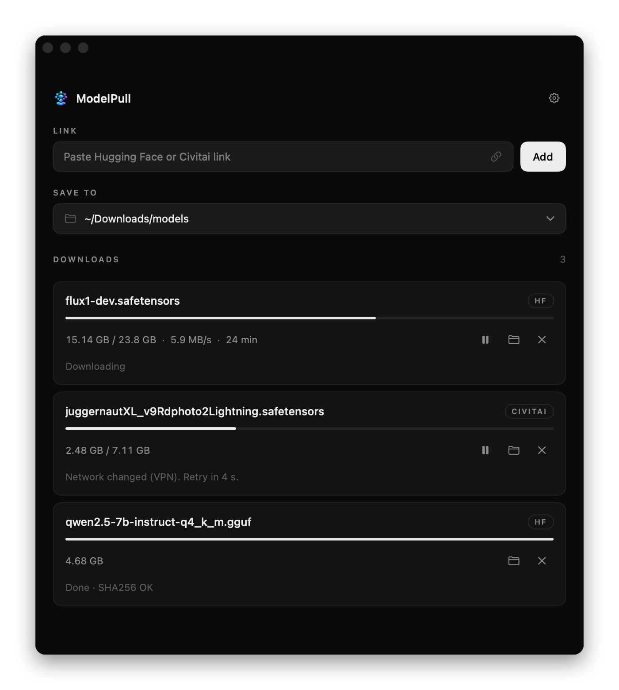

<p align="center">
  
</p>

<h1 align="center">ModelPull</h1>

<p align="center">
  Resumable downloads of big AI models from Hugging Face and Civitai.<br>
  It survives a bad connection, VPN server switches, sleep and restarts. A file is "Done" only after its full hash matches.
</p>

<p align="center">
  
</p>

## Why

A 20 GB model on an unstable link usually fails at 80%. The browser then restarts it from zero. A VPN makes this worse: every IP change kills the connection, and the signed CDN link expires.

ModelPull keeps the permanent source link. After every failure it asks the source for a fresh download link. Then it continues from the exact byte where it stopped.

## Features

- **Resume from the same byte.** Data goes to disk as it arrives. The position is saved every second, so a drop loses about 1 second of data.
- **VPN / IP change safe.** A network change restarts all connections on the new route. Every retry gets a fresh signed CDN link.
- **Survives sleep, crash and restart.** Jobs continue when you open the app again.
- **Integrity check.** A file gets its final name only after its full hash matches the source:
  - Hugging Face large files (LFS): SHA256.
  - Hugging Face small files: git blob SHA1.
  - Civitai: SHA256 from the Civitai API.
  - Every 8 MiB piece is also hashed. A bad piece is downloaded again, not the whole file.
  - If a source gives no hash, the label is "Done · not verified".
- **Pinned revision.** If the file changes on Hugging Face during the download, ModelPull stops with an error. It never mixes two versions.
- **Fast.** Up to 8 parallel connections. Each one uses its own TCP connection.
- **Private tokens.** Hugging Face and Civitai tokens stay in the macOS Keychain. On Linux they are in a file that only you can read.
- **No dependencies.** The app uses only Swift and system frameworks.

## Supported links

| Source | Link forms |
|---|---|
| Hugging Face | `https://huggingface.co/<org>/<repo>/resolve/<rev>/<file>`, `…/blob/<rev>/<file>` |
| Civitai | `https://civitai.com/models/<id>[?modelVersionId=<v>]`, `https://civitai.com/api/download/models/<versionId>` |

Gated or private Hugging Face repos and some Civitai models need a token. Add tokens in Settings (the gear icon).

## Install

Ready builds are on the [Releases page](https://github.com/novolg/ModelPull/releases/latest):

| File | For |
|---|---|
| `ModelPull-macos-arm64.zip` | macOS 14+, Apple Silicon (M1 and newer) |
| `modelpull-linux-amd64.tar.gz` | Ubuntu 24.04, x86_64 |

**macOS:** unzip and drag `ModelPull.app` to `/Applications`. The app is not notarized by Apple. On the first start, right-click the app and select **Open**. If macOS still blocks it, run:

```sh
xattr -dr com.apple.quarantine /Applications/ModelPull.app
```

**Linux:** see the [Linux](#linux-ubuntu-2404) steps below.

### macOS 14+ from source

You need only the Command Line Tools, not Xcode. An Intel Mac must build from source.

```sh
xcode-select --install          # once, if you do not have them
git clone https://github.com/novolg/ModelPull.git
cd ModelPull
scripts/build-app.sh            # -> build/ModelPull.app
open build/ModelPull.app        # or drag it to /Applications
```

The app has an ad-hoc signature. On the first start, macOS can ask you to confirm it in **System Settings → Privacy & Security**.

### Linux (Ubuntu 24.04)

The Linux version uses the same engine. Its UI is a local web page at `http://127.0.0.1:8765`, open only to your own computer.

To build it yourself (for example for arm64), use Docker on any machine:

```sh
scripts/linux-build.sh amd64    # or arm64 -> dist/modelpull-linux-<arch>.tar.gz
```

On Ubuntu:

```sh
tar -xzf modelpull-linux-amd64.tar.gz
cd modelpull-linux-amd64
./install.sh                    # add --autostart to start hidden at login
```

Then open **ModelPull** from the app menu. Closing the browser tab does not stop downloads. For more, see [`packaging/linux/README.txt`](packaging/linux/README.txt).

## Where things are

| | macOS | Linux |
|---|---|---|
| Unfinished file | `<save folder>/<name>.dlpart` | same |
| Jobs | `~/Library/Application Support/ModelPull/jobs/` | `~/.local/share/ModelPull/jobs/` |
| Tokens | Keychain | `~/.config/modelpull/tokens.json` (mode 600) |
| Logs | Console.app, subsystem `io.github.novolg.modelpull` | `~/.local/state/modelpull/modelpull.log` |

## Development

```sh
swift build --product DLChecks && .build/debug/DLChecks          # 94 checks against a fake hostile server
.build/debug/DLChecks --real <hf-or-civitai-url> <dir>            # real download; run again = resume
```

The fake server cuts connections, expires links, sends wrong data and changes the file during the download. The checks confirm that the result is always the correct file or a clear error.

Optional env vars for `--real`: `HF_TOKEN` and `CIVITAI_API_KEY` (see `.env.example`). The app itself needs no env vars.

### Layout

```
src/DLCore          engine: resolvers, range fetcher, state, hashing (macOS + Linux)
src/ModelPullApp    macOS SwiftUI app
src/ModelPullWeb    Linux app: local HTTP server + web page
tests/DLChecks      checks + real-download tool
scripts/            build, package, smoke and integrity tests
packaging/linux/    install.sh and user README
docs/               plan, architecture review, findings
```

Architecture: [`docs/ARCHITECTURE-REVIEW.md`](docs/ARCHITECTURE-REVIEW.md). Plan and status: [`docs/PLAN.md`](docs/PLAN.md).

## Upgrading from "Downloader"

ModelPull was called "Downloader" before. On the first start, ModelPull moves your old jobs (and on Linux, your tokens and settings) to the new folders. On macOS, enter your tokens and settings again.

## License

[MIT](LICENSE)
